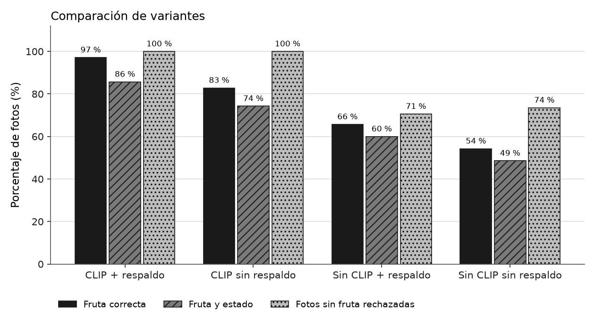
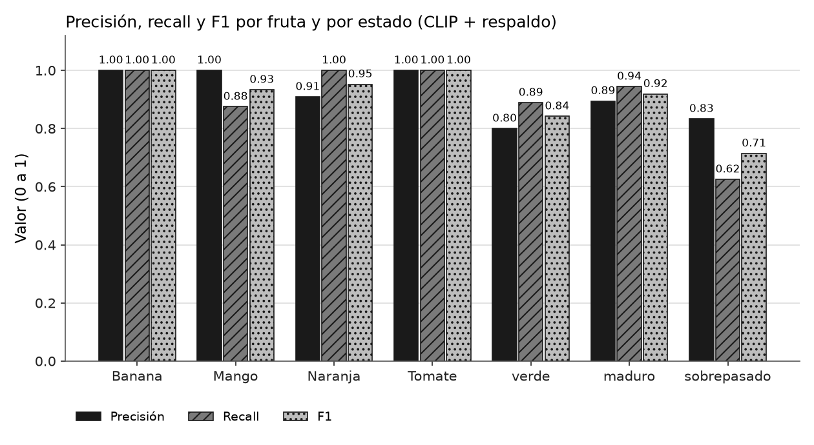
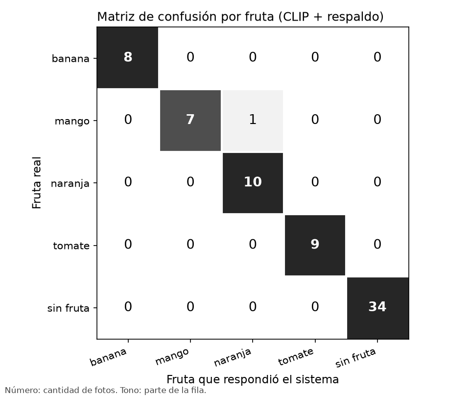
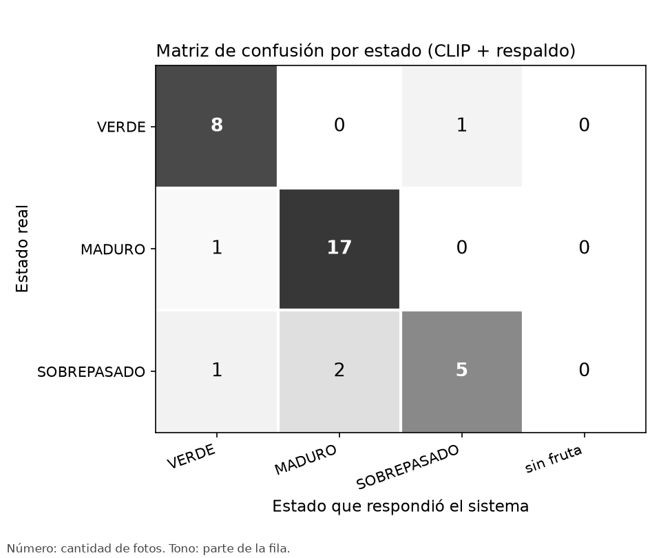
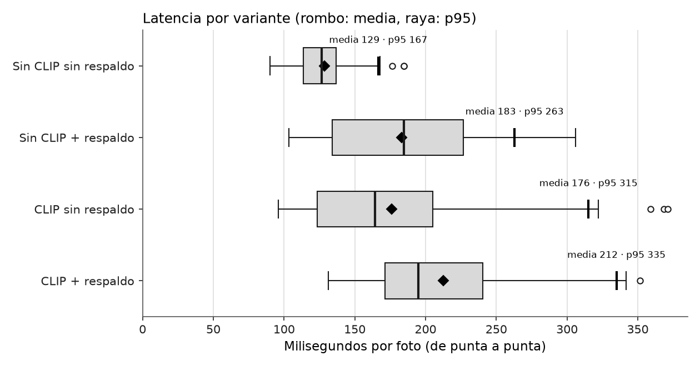

# Evaluación del modelo

Generado por `backend/evaluate.py` el 06/11/2026 10:44. 35 fotos con fruta y 34 sin fruta de `backend/tests/imagenes`, pasadas por el mismo `/predict` que usa la app.

- Modelo principal: `best.pt`, respaldo `best_v2.pt`
- Umbrales con CLIP: banana 0.25, mango 0.25, naranja 0.25, tomate 0.25
- Umbrales sin CLIP: banana 0.5, mango 0.6, naranja 0.5, tomate 0.5
- CLIP: disponible

## Resumen por variante

| Variante | Fruta correcta | Fruta y estado | Sin fruta rechazadas | Falsos positivos | Zonas dañadas | Latencia media | Latencia p95 |
| --- | --- | --- | --- | --- | --- | --- | --- |
| CLIP + respaldo | 34/35 | 30/35 | 34/34 | 0 % | 0/6 | 212 ms | 335 ms |
| CLIP sin respaldo | 29/35 | 26/35 | 34/34 | 0 % | 0/6 | 176 ms | 315 ms |
| Sin CLIP + respaldo | 23/35 | 21/35 | 24/34 | 29 % | 0/6 | 183 ms | 263 ms |
| Sin CLIP sin respaldo | 19/35 | 17/35 | 25/34 | 26 % | 0/6 | 129 ms | 167 ms |

## Métricas de la variante principal (CLIP + respaldo)

### Por fruta

Se cuentan las 69 fotos. Una foto sin fruta donde el sistema dice "naranja" es un falso positivo de naranja.

| Fruta | Precisión | Recall | F1 | VP | FP | FN |
| --- | --- | --- | --- | --- | --- | --- |
| banana | 1.00 | 1.00 | 1.00 | 8 | 0 | 0 |
| mango | 1.00 | 0.88 | 0.93 | 7 | 0 | 1 |
| naranja | 0.91 | 1.00 | 0.95 | 10 | 1 | 0 |
| tomate | 1.00 | 1.00 | 1.00 | 9 | 0 | 0 |

F1 promedio (macro) de las cuatro frutas: 0.97

### Por estado

Solo fotos con fruta. Se compara el estado aunque la fruta haya salido mal.

| Estado | Precisión | Recall | F1 | VP | FP | FN |
| --- | --- | --- | --- | --- | --- | --- |
| VERDE | 0.80 | 0.89 | 0.84 | 8 | 2 | 1 |
| MADURO | 0.89 | 0.94 | 0.92 | 17 | 2 | 1 |
| SOBREPASADO | 0.83 | 0.62 | 0.71 | 5 | 1 | 3 |

### Matriz de confusión por fruta

Filas: fruta real. Columnas: lo que respondió el sistema.

| Real \ Respuesta | banana | mango | naranja | tomate | sin fruta |
| --- | --- | --- | --- | --- | --- |
| banana | 8 | 0 | 0 | 0 | 0 |
| mango | 0 | 7 | 1 | 0 | 0 |
| naranja | 0 | 0 | 10 | 0 | 0 |
| tomate | 0 | 0 | 0 | 9 | 0 |
| sin fruta | 0 | 0 | 0 | 0 | 34 |

### Matriz de confusión por estado

| Real \ Respuesta | VERDE | MADURO | SOBREPASADO | sin fruta |
| --- | --- | --- | --- | --- |
| VERDE | 8 | 0 | 1 | 0 |
| MADURO | 1 | 17 | 0 | 0 |
| SOBREPASADO | 1 | 2 | 5 | 0 |

### Fotos sin fruta y latencia

- Tasa de falsos positivos en fotos sin fruta: 0.0 % (0 de 34)
- Latencia de punta a punta por foto: media 212 ms, mediana 195 ms, p95 335 ms, máxima 351 ms
- Tiempo medio medido dentro del servidor (`elapsed_ms`): 209 ms
- Detecciones descartadas por filtro: area 9, clip 40, forma 9

## Detalle por foto (CLIP + respaldo)

| Tipo | Archivo | Esperado | Obtenido | Fruta | Estado | Zonas dañadas | Modelo | Descartes | ms |
| --- | --- | --- | --- | --- | --- | --- | --- | --- | --- |
| positiva | banana_madura_01.jpg | banana MADURO | banana MADURO (0.94) | sí | sí | - | best.pt | - | 174 |
| positiva | banana_madura_02.jpg | banana MADURO | banana MADURO (0.76) | sí | sí | - | best.pt | - | 243 |
| positiva | banana_madura_fondo_blanco.jpg | banana MADURO | banana MADURO (0.94) | sí | sí | - | best.pt | - | 155 |
| positiva | banana_madura_manchas_01.jpg | banana MADURO | banana MADURO (0.68) | sí | sí | 0 (se esperaban) | best.pt | area 4 | 179 |
| positiva | banana_sobrepasada_01.jpg | banana SOBREPASADO | banana SOBREPASADO (0.49) | sí | sí | - | best.pt | - | 303 |
| positiva | banana_sobrepasada_02.jpg | banana SOBREPASADO | banana SOBREPASADO (0.50) | sí | sí | - | best.pt | - | 179 |
| positiva | banana_verde_01.jpg | banana VERDE | banana VERDE (0.52) | sí | sí | - | best.pt | - | 335 |
| positiva | banana_verde_02.jpg | banana VERDE | banana VERDE (0.52) | sí | sí | - | best.pt | - | 300 |
| positiva | mango_maduro_01.jpg | mango MADURO | mango MADURO (0.97) | sí | sí | - | best.pt | - | 180 |
| positiva | mango_maduro_02.jpg | mango MADURO | mango MADURO (0.61) | sí | sí | - | best.pt | clip 1 | 172 |
| positiva | mango_maduro_manchas_01.jpg | mango MADURO | naranja VERDE (0.95) | no | no | 0 (se esperaban) | best_v2.pt | - | 260 |
| positiva | mango_sobrepasado_01.jpg | mango SOBREPASADO | mango MADURO (0.87) | sí | no | - | best.pt | clip 3, forma 1 | 226 |
| positiva | mango_sobrepasado_02.jpg | mango SOBREPASADO | mango SOBREPASADO (0.98) | sí | sí | - | best.pt | - | 164 |
| positiva | mango_verde_01.jpg | mango VERDE | mango VERDE (0.93) | sí | sí | - | best.pt | - | 154 |
| positiva | mango_verde_02.jpg | mango VERDE | mango VERDE (0.88) | sí | sí | - | best.pt | area 3 | 217 |
| positiva | mango_verde_manchas_01.jpg | mango VERDE | mango SOBREPASADO (0.96) | sí | no | 0 (se esperaban) | best.pt | - | 165 |
| positiva | naranja_madura_01.jpg | naranja MADURO | naranja MADURO (0.95) | sí | sí | - | best_v2.pt | - | 243 |
| positiva | naranja_madura_02.jpg | naranja MADURO | naranja MADURO (0.40) | sí | sí | - | best.pt | - | 250 |
| positiva | naranja_madura_cortada_con_otras.jpg | naranja MADURO | naranja MADURO (0.42) | sí | sí | - | best_v2.pt | clip 1 | 319 |
| positiva | naranja_madura_entera.jpg | naranja MADURO | naranja MADURO (0.71) | sí | sí | - | best.pt | - | 141 |
| positiva | naranja_madura_fondo_blanco.jpg | naranja MADURO | naranja MADURO (0.95) | sí | sí | - | best.pt | - | 160 |
| positiva | naranja_madura_manchas_01.jpg | naranja MADURO | naranja MADURO (0.87) | sí | sí | 0 (se esperaban) | best_v2.pt | - | 191 |
| positiva | naranja_sobrepasada_01.jpg | naranja SOBREPASADO | naranja MADURO (0.64) | sí | no | - | best.pt | - | 154 |
| positiva | naranja_sobrepasada_02.jpg | naranja SOBREPASADO | naranja VERDE (0.78) | sí | no | - | best_v2.pt | - | 231 |
| positiva | naranja_verde_01.jpg | naranja VERDE | naranja VERDE (0.55) | sí | sí | - | best.pt | - | 187 |
| positiva | naranja_verde_02.jpg | naranja VERDE | naranja VERDE (0.83) | sí | sí | - | best.pt | area 2, clip 6 | 212 |
| positiva | tomate_maduro_01.jpg | tomate MADURO | tomate MADURO (0.88) | sí | sí | - | best_v2.pt | - | 256 |
| positiva | tomate_maduro_02.jpg | tomate MADURO | tomate MADURO (0.50) | sí | sí | - | best.pt | - | 311 |
| positiva | tomate_maduro_fondo_blanco.jpg | tomate MADURO | tomate MADURO (0.63) | sí | sí | - | best.pt | - | 138 |
| positiva | tomate_maduro_manchas_01.jpg | tomate MADURO | tomate MADURO (0.85) | sí | sí | 0 (se esperaban) | best.pt | - | 171 |
| positiva | tomate_maduro_manchas_02.jpg | tomate MADURO | tomate MADURO (0.97) | sí | sí | 0 (se esperaban) | best.pt | - | 212 |
| positiva | tomate_sobrepasado_01.jpg | tomate SOBREPASADO | tomate SOBREPASADO (0.96) | sí | sí | - | best.pt | - | 131 |
| positiva | tomate_sobrepasado_02.jpg | tomate SOBREPASADO | tomate SOBREPASADO (0.96) | sí | sí | - | best.pt | clip 1 | 196 |
| positiva | tomate_verde_01.jpg | tomate VERDE | tomate VERDE (0.32) | sí | sí | - | best.pt | - | 177 |
| positiva | tomate_verde_02.jpg | tomate VERDE | tomate VERDE (0.95) | sí | sí | - | best.pt | - | 158 |
| negativa | bus.jpg | sin fruta | sin fruta (sin_deteccion) | sí | - | - | - | - | 195 |
| negativa | cv_apple.jpg | sin fruta | sin fruta (no_es_fruta) | sí | - | - | - | clip 2 | 311 |
| negativa | cv_baboon.jpg | sin fruta | sin fruta (sin_deteccion) | sí | - | - | - | - | 184 |
| negativa | cv_box.png | sin fruta | sin fruta (sin_deteccion) | sí | - | - | - | - | 143 |
| negativa | cv_building.jpg | sin fruta | sin fruta (sin_deteccion) | sí | - | - | - | - | 144 |
| negativa | cv_home.jpg | sin fruta | sin fruta (sin_deteccion) | sí | - | - | - | - | 163 |
| negativa | cv_lena.jpg | sin fruta | sin fruta (no_es_fruta) | sí | - | - | - | clip 1 | 183 |
| negativa | cv_pic1.png | sin fruta | sin fruta (sin_deteccion) | sí | - | - | - | - | 175 |
| negativa | fruta_limon_01.jpg | sin fruta | sin fruta (no_es_fruta) | sí | - | - | - | clip 3 | 224 |
| negativa | fruta_limon_02.jpg | sin fruta | sin fruta (no_es_fruta) | sí | - | - | - | clip 3 | 221 |
| negativa | fruta_manzana_roja_01.jpg | sin fruta | sin fruta (no_es_fruta) | sí | - | - | - | clip 2 | 335 |
| negativa | fruta_manzana_roja_02.jpg | sin fruta | sin fruta (no_es_fruta) | sí | - | - | - | clip 2 | 237 |
| negativa | fruta_manzana_verde_01.jpg | sin fruta | sin fruta (no_es_fruta) | sí | - | - | - | clip 3 | 295 |
| negativa | fruta_manzana_verde_02.jpg | sin fruta | sin fruta (no_es_fruta) | sí | - | - | - | clip 3 | 338 |
| negativa | fruta_pera_01.jpg | sin fruta | sin fruta (no_es_fruta) | sí | - | - | - | clip 3 | 351 |
| negativa | fruta_pera_02.jpg | sin fruta | sin fruta (no_es_fruta) | sí | - | - | - | clip 2 | 342 |
| negativa | interior_01.jpg | sin fruta | sin fruta (sin_deteccion) | sí | - | - | - | - | 232 |
| negativa | interior_02.jpg | sin fruta | sin fruta (sin_deteccion) | sí | - | - | - | - | 184 |
| negativa | neg_pared_naranja.jpg | sin fruta | sin fruta (forma) | sí | - | - | - | forma 2 | 205 |
| negativa | neg_ruido.jpg | sin fruta | sin fruta (sin_deteccion) | sí | - | - | - | - | 192 |
| negativa | neg_techo_blanco.jpg | sin fruta | sin fruta (sin_deteccion) | sí | - | - | - | - | 182 |
| negativa | neg_techo_lampara.jpg | sin fruta | sin fruta (no_es_fruta) | sí | - | - | - | clip 1 | 230 |
| negativa | neg_techo_luz_calida.jpg | sin fruta | sin fruta (forma) | sí | - | - | - | forma 2 | 196 |
| negativa | neg_techo_machimbre.jpg | sin fruta | sin fruta (forma) | sí | - | - | - | forma 2 | 219 |
| negativa | obj_calabaza_01.jpg | sin fruta | sin fruta (no_es_fruta) | sí | - | - | - | clip 1 | 217 |
| negativa | obj_pelota_01.jpg | sin fruta | sin fruta (no_es_fruta) | sí | - | - | - | clip 1 | 284 |
| negativa | obj_pelota_02.jpg | sin fruta | sin fruta (no_es_fruta) | sí | - | - | - | clip 1 | 240 |
| negativa | pared_01.jpg | sin fruta | sin fruta (sin_deteccion) | sí | - | - | - | - | 179 |
| negativa | pared_02.jpg | sin fruta | sin fruta (sin_deteccion) | sí | - | - | - | - | 177 |
| negativa | pared_03.jpg | sin fruta | sin fruta (forma) | sí | - | - | - | forma 2 | 144 |
| negativa | persona_01.jpg | sin fruta | sin fruta (sin_deteccion) | sí | - | - | - | - | 213 |
| negativa | persona_02.jpg | sin fruta | sin fruta (sin_deteccion) | sí | - | - | - | - | 152 |
| negativa | persona_03.jpg | sin fruta | sin fruta (sin_deteccion) | sí | - | - | - | - | 167 |
| negativa | zidane.jpg | sin fruta | sin fruta (sin_deteccion) | sí | - | - | - | - | 164 |
